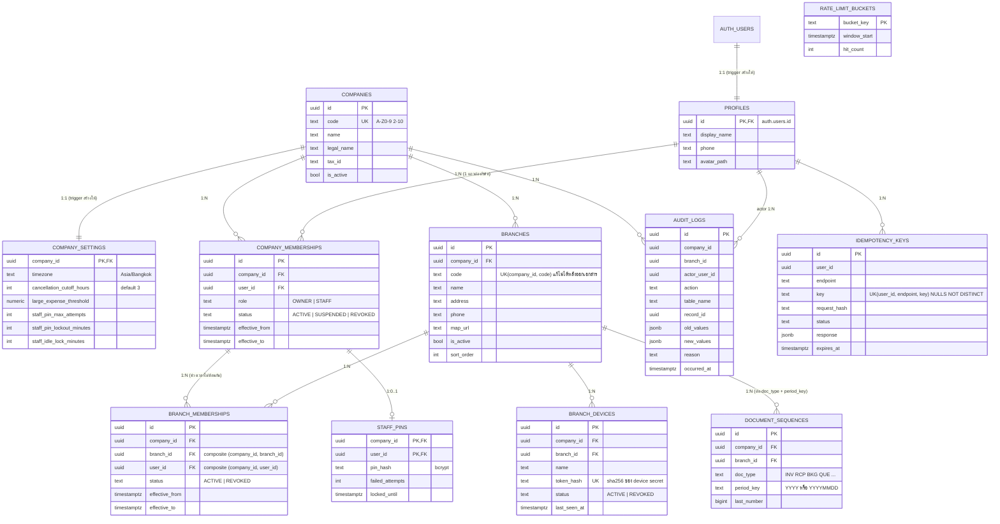

# Phase 1 — ER Diagram และ Cardinality

ขอบเขต: Foundation (บริษัท สาขา โปรไฟล์ สมาชิก/สิทธิ์ Audit Log เลขรันเอกสาร Idempotency Rate Limit เครื่องประจำสาขาและ PIN พนักงาน)

## Cardinality และกฎสำคัญ

| ความสัมพันธ์ | Cardinality | วิธีบังคับ |
|---|---|---|
| auth.users → profiles | 1:1 | FK `profiles.id → auth.users.id` + trigger `on_auth_user_created` |
| companies → company_settings | 1:1 | PK = FK + trigger สร้างแถวอัตโนมัติ |
| companies → branches | 1:N | FK + `UNIQUE (company_id, code)` + `UNIQUE (company_id, id)` สำหรับ composite FK |
| profiles ↔ companies | M:N ผ่าน company_memberships | `UNIQUE (company_id, user_id)` 1 แถวต่อคนต่อบริษัท ประวัติการเปลี่ยน role อยู่ใน audit_logs |
| company_memberships → branch_memberships | 1:N | composite FK `(company_id, user_id)` และ `(company_id, branch_id)` กันข้ามบริษัท; exclusion constraint กันไม่ให้ 1 คนมีสาขา ACTIVE ซ้อนเวลากัน (พนักงานประจำสาขาเดียวในช่วงเวลาหนึ่ง) |
| company_memberships → staff_pins | 1:0..1 | PK `(company_id, user_id)` + composite FK |
| branches → branch_devices | 1:N | composite FK `(company_id, branch_id)` |
| branches → document_sequences | 1:N | `UNIQUE (company_id, branch_id, doc_type, period_key)` |

## หมายเหตุการออกแบบ

- **Role** มาจาก `company_memberships.role` เท่านั้น ไม่อ่านจาก JWT claim หรือ user_metadata
- **OWNER** ได้สิทธิ์เจ้าของเฉพาะเมื่อ session เป็น `aal2` (ผ่าน TOTP แล้ว) ตรวจใน `private.is_company_owner()`
- **CUSTOMER** ไม่มี membership จะผูกกับ `customers.auth_user_id` ใน Phase 3
- **audit_logs** ไม่มี `updated_at` เพราะเป็น append-only (มี trigger ห้าม UPDATE/DELETE/TRUNCATE)
- **idempotency_keys / rate_limit_buckets** เป็นตารางควบคุมระบบ ไม่มี company_id เพราะใช้ข้ามบริษัทได้ (เช่น Public Endpoint ของ Guest) และไม่มี Policy ให้ client เข้าถึงเลย
- **document_sequences** ใช้ `period_key` แทน `fiscal_year` (ตามข้อตกลงข้อ 6) รอบปี/วันคำนวณตาม `company_settings.timezone`
