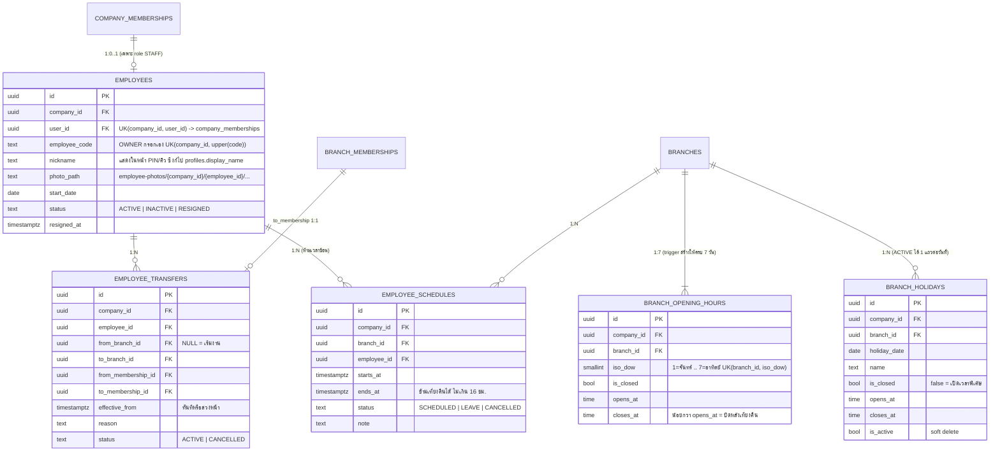

# Phase 2 — ER Diagram และ Cardinality

ขอบเขต: เวลาทำการและวันหยุดสาขา, พนักงาน, ประวัติย้ายสาขา, ตารางงาน, การยืนยันตัวตนซ้ำ (step-up TOTP), รูปพนักงาน (Storage)

## กฎสำคัญ

| เรื่อง | วิธีบังคับ |
|---|---|
| พนักงาน 1:1 membership และต้องเป็น STAFF | composite FK `(company_id, user_id)` + UNIQUE + trigger ตรวจ role |
| OWNER ได้คนเดียวต่อบริษัท | partial unique index `company_memberships (company_id) WHERE role='OWNER' AND status='ACTIVE'` |
| ย้ายสาขา | `transfer_employee()` ปิด branch_membership เดิม (effective_to) + สร้างใหม่ + บันทึก transfer ใน Transaction เดียว; ห้ามถ้ามีกะที่สาขาเดิมหลังวันมีผล หรือมีการย้ายที่รอมีผลอยู่ |
| กะงาน | exclusion constraint ห้ามซ้อนต่อพนักงาน (ยกเว้น CANCELLED); trigger ตรวจว่าพนักงานสังกัดสาขานั้นตลอดช่วงกะ; CANCELLED เป็นสถานะสุดท้าย |
| ระงับ (INACTIVE) | membership = SUSPENDED, ลบ PIN, ban บัญชี (Edge Function) — สิทธิ์สาขาเดิมคงไว้เพื่อเปิดใช้ใหม่ |
| ลาออก (RESIGNED) | membership = REVOKED, ปิดสิทธิ์สาขา, ยกเลิกการย้ายที่รอมีผลและกะในอนาคต, ลบ PIN, ban บัญชี — สถานะสุดท้าย |
| การกระทำเสี่ยงสูง | `private.require_owner_step_up()` ต้องเป็น OWNER aal2 และ JWT `amr` มี `totp` ภายใน 5 นาที |
