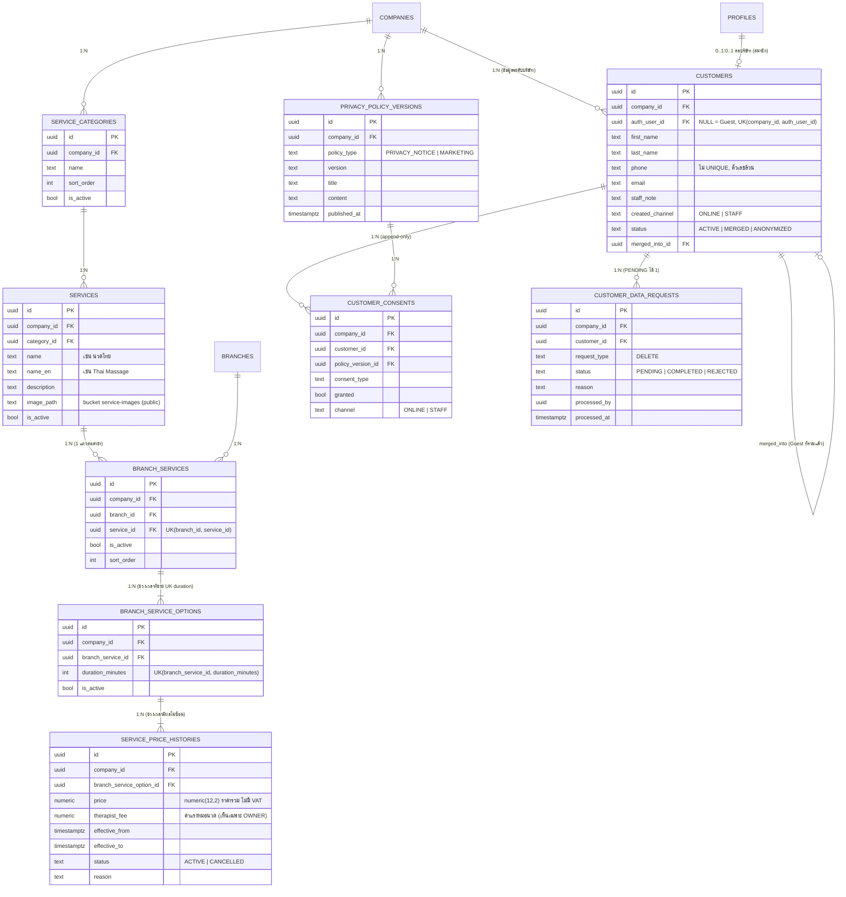

# Phase 3 — ER Diagram และ Cardinality

ขอบเขต: บริการและราคา (บริการกลาง + บริการรายสาขา + ประวัติราคา), ลูกค้า (สมาชิก/Guest), ความยินยอม PDPA, คำขอลบข้อมูล

## กฎสำคัญ

| เรื่อง | วิธีบังคับ |
|---|---|
| ช่วงเวลาบริการ | 1 บริการมีหลายช่วงเวลา (`branch_service_options`) ต่อสาขา แต่ละช่วงมีราคา + ค่าแรงของตัวเอง |
| ราคาปัจจุบัน | แถว `service_price_histories` ที่ ACTIVE และครอบเวลาปัจจุบัน ต่อช่วงเวลา (exclusion constraint ห้ามช่วงซ้อน) |
| ค่าแรงหมอนวด | ไม่ grant คอลัมน์ `therapist_fee` ให้ client — OWNER อ่านผ่าน `owner_service_pricing()` |
| บันทึกราคา | `save_branch_service_pricing()` บันทึกทุกช่วงเวลาของบริการพร้อมกัน (หลายสาขาได้ใน Transaction เดียว); แก้ของเดิมต้อง step-up TOTP + เหตุผล, มีผลทันที/ล่วงหน้า ห้ามย้อนหลัง |
| ลูกค้าเห็นราคา | view `v_public_branch_services` (security_invoker) เห็นเฉพาะราคาที่มีผลแล้ว ไม่เห็นราคาล่วงหน้า |
| ข้อมูลลูกค้า | ไม่มี SELECT ตรงสำหรับ STAFF/ลูกค้า — ใช้ Function: ค้นหาด้วยเบอร์เต็ม (ปิดบัง), ดูรายละเอียด (บันทึก audit) |
| จับคู่ Guest | `merge_customers()` พนักงานยืนยันเอง, ต้นทางต้องเป็น Guest, ไม่ลบแถว (status MERGED) |
| ความยินยอม | append-only แถวล่าสุดต่อประเภทคือสถานะปัจจุบัน |
| ลบข้อมูล (PDPA) | ลูกค้าส่งคำขอ → OWNER (step-up) อนุมัติ → anonymize customers/profiles + Edge Function เปลี่ยนอีเมลและ ban บัญชี Auth |
