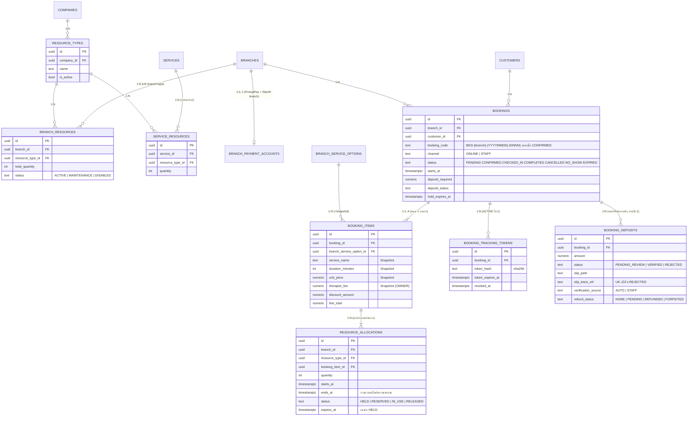

# Phase 4 — ER Diagram และ Cardinality

ขอบเขต: ทรัพยากร (เตียง/อุปกรณ์), การจัดสรรตามเวลา, การจอง (สมาชิก/Guest/พนักงาน), มัดจำผ่านสลิป (SlipOK + พนักงานตรวจ), Tracking Token, ยกเลิก/No-show/คืนมัดจำ

## กฎสำคัญ

| เรื่อง | วิธีบังคับ |
|---|---|
| Capacity | `private.assert_capacity()` ล็อก `branch_resources` (FOR UPDATE) แล้วคำนวณยอดใช้สูงสุดในช่วงเวลา (HELD ที่ยังไม่หมดอายุ + RESERVED + IN_USE) ต้องไม่เกิน `total_quantity`; เรียกจาก trigger ทุกครั้งที่ allocation กลายเป็น active |
| เวลาเผื่อ | allocation ยาว = ระยะบริการ + `booking_buffer_minutes` |
| State Booking | `private.transition_booking()` ตามตารางในสเปก สถานะสุดท้ายเปลี่ยนไม่ได้ |
| มัดจำออนไลน์ | ยอดคงที่ต่อคน × จำนวนรายการ; จองแล้ว = PENDING + HELD (`booking_hold_minutes`); สลิปผ่าน SlipOK = CONFIRMED + RESERVED; ตรวจไม่ได้ = PENDING_REVIEW (ขยายเวลากันที่) ให้พนักงานตัดสิน |
| สลิปซ้ำ | SlipOK `log: true` + unique `slip_trans_ref` ใน DB |
| ยกเลิก | สมาชิกยกเลิกเองก่อนนัด ≥ `cancellation_cutoff_hours`; Guest ยกเลิกเองไม่ได้; ทันเวลา = คืนมัดจำ (REFUND PENDING → พนักงานบันทึกการโอนคืน), ช้า/No-show = ริบ |
| Token | สุ่ม 256 บิต เก็บ sha256, หมดอายุ 7 วันหลังนัด, ใช้ดูสถานะ/ส่งสลิปเท่านั้น |
| Guest | สร้างลูกค้า Guest ใหม่ทุกครั้ง (ไม่รวมอัตโนมัติ) — พนักงานจับคู่ภายหลัง |
