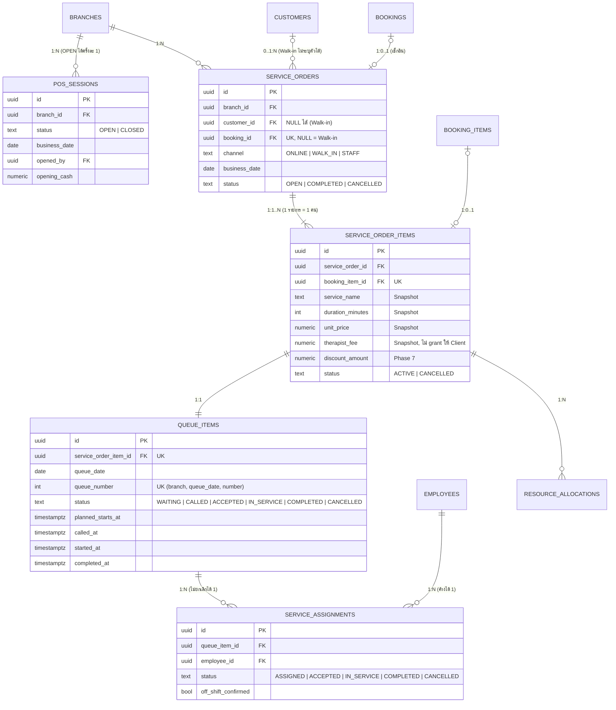

# Phase 5 — ER Diagram และ Cardinality

ขอบเขต: กะ POS (เปิดกะ), Walk-in, เช็กอินการจอง, Service Order, คิว, การมอบหมายหมอ, Realtime
(ปิดกะ/นับเงิน, Invoice, Payment, ทิป, เงินเข้า-ออกลิ้นชัก อยู่ใน Phase 7)

## กฎสำคัญ

| เรื่อง | บังคับที่ |
| --- | --- |
| เปิดกะได้ครั้งละ 1 กะต่อสาขา | Partial unique index `pos_sessions_one_open` + ล็อกแถวสาขาใน `pos_open_session` |
| เลขคิวไม่ซ้ำ/ไม่ข้าม รายวันต่อสาขา | `document_sequences` (QUE, รอบวัน) + unique `(branch_id, queue_date, queue_number)` |
| วันทำการ (หลังเที่ยงคืนที่ร้านยังเปิด = วันก่อนหน้า) | `private.branch_window_at` |
| Walk-in จองเตียงทันที (RESERVED) | `private.reserve_walkin` (ล็อก + ตรวจ capacity) และ trigger capacity เดิม |
| เช็กอินไม่สร้าง Allocation ใหม่ | `pos_check_in_booking` เปลี่ยนของเดิมเป็น IN_USE และผูก `service_order_item_id` (ผูกได้ครั้งเดียว) |
| เริ่มบริการ = เลื่อนเวลาเตียงตามเวลาจริง | `queue_start` (ตรวจ capacity ใหม่ เต็มแล้ว = CAPACITY_FULL) |
| จบบริการ = คืนเตียงทันที | `queue_complete` |
| 1 รายการ = หมอ 1 คน | Partial unique `service_assignments_one_per_queue` |
| หมอ 1 คน = 1 คิวที่ยังไม่จบ | Partial unique `service_assignments_one_active_per_employee` + ล็อกแถวพนักงาน |
| หมอไม่มีกะ = ต้องยืนยัน | `private.assert_therapist_available` (hint OFF_SHIFT) |
| State transition คิว/การมอบหมาย/Order | Trigger guard ทุกตาราง |
| ห้าม DELETE, ทุกการเปลี่ยนแปลงผ่าน Function | `tg_no_delete` + ไม่มี grant insert/update ให้ Client |
| ค่ามือหมอไม่ออกไปที่ Client | Column grant ของ `service_order_items` |
| Realtime | `queue_items`, `service_orders`, `pos_sessions` ใน publication `supabase_realtime` (ผ่าน RLS สาขา) |

## Workflow

- **Walk-in:** `pos_available_starts` (เสนอเวลาว่างเร็วสุด ทุก 5 นาที) → `pos_create_walkin` → คิว WAITING
- **ลูกค้าที่จอง:** `pos_check_in_booking` → การจอง CHECKED_IN → คิว WAITING
- **คิว:** `queue_call` (หน้าร้านเลือกหมอ) → `queue_accept` (หมอรับด้วย PIN ของตัวเอง หรือหน้าร้านกดแทน) → `queue_start` → `queue_complete`
- **ยกเลิก:** `queue_cancel` ก่อนเริ่มบริการเท่านั้น (Order จากการจองต้องเหลืออย่างน้อย 1 รายการ)
- **เพิ่มบริการ/ต่อเวลา:** `pos_add_order_items` (Order ที่เสร็จแล้วกลับเป็น OPEN)
- ทุกรายการเสร็จ → Order COMPLETED และการจอง COMPLETED
