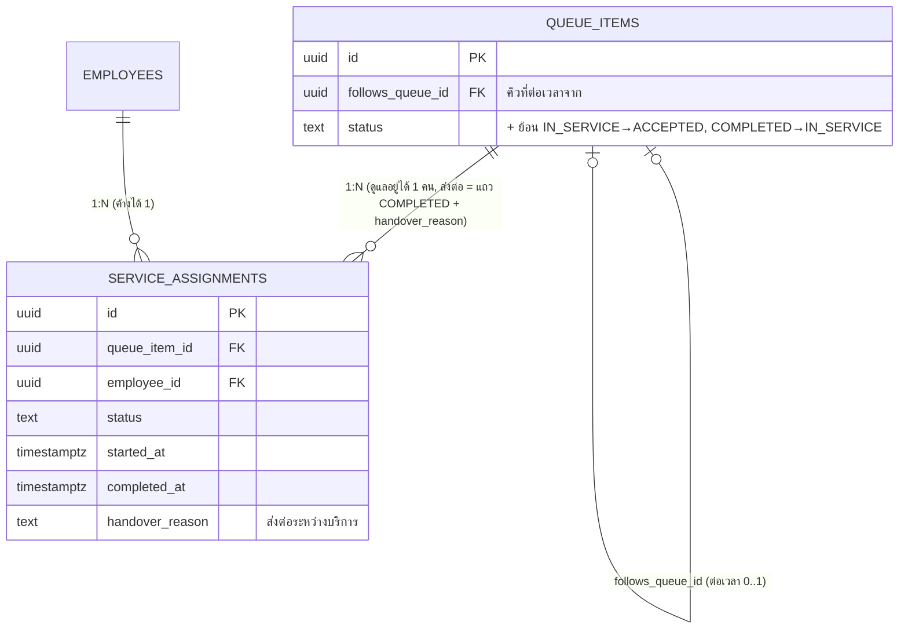

# Phase 6 — Service Management

ขอบเขต: มุมมองหมอ (คิวของฉัน, หมอกดคิวด้วย PIN บนเครื่องสาขา), เปลี่ยนหมอระหว่างบริการ, ต่อเวลา,
ย้อนเริ่ม/จบบริการ, ประวัติบริการ (ลูกค้า / หมอ / OWNER), แดชบอร์ด STAFF

ไม่มีตารางใหม่ — เพิ่มคอลัมน์และเปลี่ยน constraint ของ Phase 5

## กฎสำคัญ

| เรื่อง | บังคับที่ |
| --- | --- |
| 1 คิวมีหมอที่ดูแลอยู่ได้ 1 คน | `service_assignments_one_active_per_queue` (ASSIGNED/ACCEPTED/IN_SERVICE) |
| ค่ามือ = ค่าคงที่ที่ Snapshot ไว้ ไม่หักตามส่วนลด | `service_order_items.therapist_fee` |
| เปลี่ยนหมอกลางทาง = แบ่งค่ามือตามเวลาที่ทำจริง | `private.assignment_fee` (คิวต้องจบแล้ว, ยอดประมาณการ — ยอดจริง Phase 8) |
| ต่อเวลา = หมอคนเดิม เริ่มทันทีเมื่อจบรายการเดิม | `queue_extend` + `queue_complete` (ถ้าเตียงไม่พอ คิวต่อเวลารอเรียกตามปกติ) |
| ต่อเวลาใช้เตียงเดิมต่อ | เวลาเผื่อทำความสะอาดของรายการเดิมย้ายไปหลังรายการต่อเวลา |
| ย้อนเริ่ม/จบ ภายใน 15 นาที + เหตุผล | `queue_undo_start`, `queue_undo_complete` (Phase 7: ต้องยังไม่ออก Invoice) |
| ย้อนจบ = จองเตียงกลับ ถ้าถูกใช้ไปแล้วย้อนไม่ได้ | trigger capacity เดิม (CAPACITY_FULL) |
| หมอกดคิวด้วย PIN | Edge Function `queue-pin-action` → `device_verify_staff_pin` → `device_queue_action` (เฉพาะคิวของตัวเองในสาขาของเครื่อง, บันทึกเป็นชื่อหมอ) |
| หมอเห็นค่ามือของตัวเองเท่านั้น | `my_work_history` (ตาราง `therapist_fee` ยังไม่ grant ให้ Client) |
| สรุปรายหมอ | `therapist_work_summary` (OWNER aal2) |
| ประวัติบริการลูกค้า + PDPA export | `my_service_history`, `export_my_data.service_history` |
