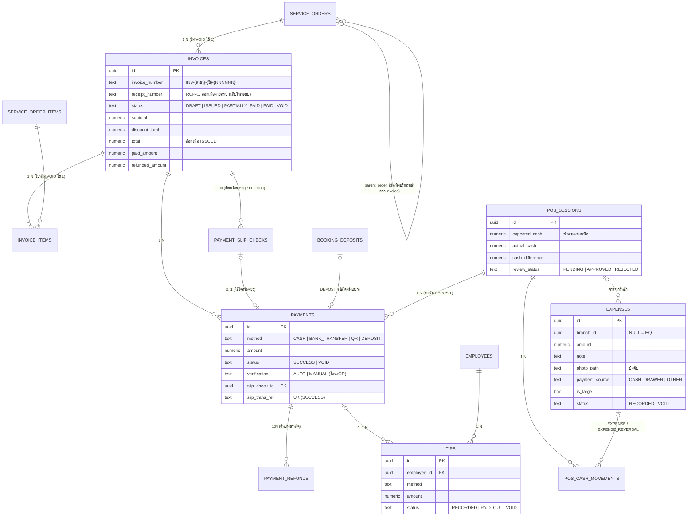

# Phase 7 — การเงินหน้าร้าน

ขอบเขต: Invoice, ส่วนลด, รับเงิน (เงินสด / โอน / QR / มัดจำ), ตรวจสลิป, Void, คืนเงิน, ใบเสร็จ (เก็บในระบบ),
เงินเข้าออกลิ้นชัก, ทิป, ปิดกะ + OWNER ตรวจ, รายจ่าย

## กฎสำคัญ

| เรื่อง | บังคับที่ |
| --- | --- |
| 1 Order มี Invoice หลัก 1 ใบ | `invoices_one_per_order` (ไม่นับ VOID) |
| ออก Invoice เมื่อไม่มีรายการที่ยังไม่เริ่ม | `pos_create_invoice` (hint `PENDING_ITEMS`) |
| ยอดล็อกเมื่อ ISSUED แก้ได้โดย Void แล้วออกใหม่ | `tg_invoices_guard`, `tg_invoice_items_guard` |
| ออก Invoice แล้วย้อน/ยกเลิกคิวของรายการนั้นไม่ได้ | `tg_queue_items_invoice_lock` |
| เพิ่มบริการหลังออก Invoice = Order ใหม่ | `private.order_for_new_items` (`parent_order_id`) |
| ส่วนลดเกินเพดาน STAFF (ค่าเริ่มต้น 20%) = OWNER + TOTP | `pos_set_invoice_discount` |
| รับเงินต้องมีกะเปิด, กันรับซ้ำ, ห้ามเกินยอดค้าง | `pos_record_payment` + Idempotency + `invoices_paid_amount_chk` |
| โอน/QR ต้องมีสลิปที่ระบบตรวจ (AUTO) หรือพนักงานยืนยันพร้อมเหตุผล (MANUAL) | `payment_slip_checks` (service role เท่านั้น) + `payments_slip_chk` |
| สลิปใช้ซ้ำไม่ได้ (รวมสลิปมัดจำ) | unique `slip_trans_ref` + ตรวจ `booking_deposits` |
| มัดจำหักอัตโนมัติตอนออก Invoice | `pos_issue_invoice` → Payment `DEPOSIT` (ไม่เข้าลิ้นชัก) |
| Void: ยังไม่รับเงิน = STAFF; รับแล้ว = OWNER + TOTP และเงินต้องอยู่ในกะที่เปิด | `pos_void_invoice` |
| คืนเงิน = OWNER + TOTP, บางส่วนได้, เงินสดต้องมีกะเปิด | `pos_refund_payment` |
| Expected Cash = เปิด + เงินสด + ทิปเงินสด + เงินเข้า − เงินออก − คืนเงินสด | `private.session_figures` |
| ปิดกะแบบไม่เห็นยอดก่อน, ผลต่าง ≠ 0 ต้องมีเหตุผล, ปิดแล้วห้ามรับเงิน | `pos_close_session`, column grant ของ `pos_sessions` |
| รายจ่ายจากลิ้นชัก = CASH_OUT ใน Transaction เดียวกัน, ต้องแนบรูป | `pos_record_expense` |
| ยกเลิกรายจ่าย: กะยังเปิด = ทันที; นอกนั้น STAFF ขอ → OWNER อนุมัติ | `pos_void_expense`, `pos_reject_expense_void` |
| ข้อมูลการเงินห้ามลบ/แก้ | `tg_no_delete`, guards, ไม่มี grant เขียนให้ Client |

ความต่างจากสเปก (ตกลงแล้ว): QR ยืนยันด้วยสลิป (SlipOK หรือพนักงาน) แทน Webhook, ใบเสร็จไม่ออกให้ลูกค้า,
รายจ่ายไม่มีประเภท (จำนวนเงิน + หมายเหตุ + รูป)
