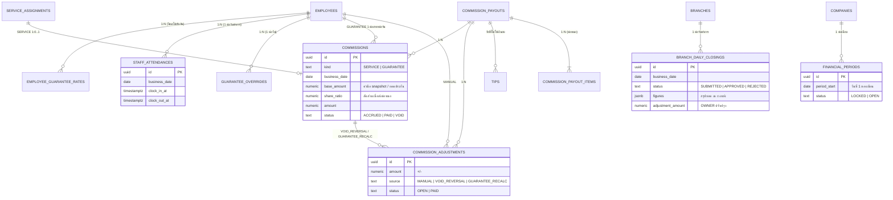

# Phase 8 — การเงินส่วนกลาง

ขอบเขต: ประกันมือหมอประจำ + ลงเวลา, คอมมิชชันและรอบจ่าย, ปิดยอดรายวัน, งวดบัญชี, แดชบอร์ด OWNER, รายงาน

## กฎสำคัญ

| เรื่อง | บังคับที่ |
| --- | --- |
| ค่ามือเข้าเกณฑ์เมื่อบริการจบ + Invoice จ่ายครบ (ไม่คืนเงินเต็มจำนวน) | `private.sync_commissions` ขั้น 1 |
| Void/คืนเงินเต็ม: ยังไม่จ่าย = VOID, จ่ายแล้ว = รายการกลับ −ยอด (ครั้งเดียว) | ขั้น 2 + unique `commission_adjustments_reversal_key` |
| ประกันมือ = max(ยอดประกัน − ค่ามือของวัน, 0) เฉพาะหมอประจำที่มีกะ | `private.compute_guarantee` |
| ไม่ครบกะ (ลงเวลาเข้า/ออกไม่ครอบกะ ± grace) = ไม่ได้ประกัน เว้นแต่ OWNER ให้ | `staff_attendances`, `guarantee_overrides` |
| ประกันมือคำนวณอัตโนมัติ (ไม่ต้องอนุมัติ) จนกว่าจะจ่าย หลังจ่ายปรับรอบถัดไป | ขั้น 3 (`GUARANTEE_RECALC`) |
| ไม่นับทิปในประกันมือ/ค่ามือ, ทิปที่ไม่ใช่เงินสดจ่ายในรอบจ่าย | `tips.commission_payout_id` |
| รอบจ่าย: ร่าง → ยืนยัน (OWNER + TOTP) / ยกเลิก, ร่างได้ทีละ 1, ยอดติดลบยกไป | `create/confirm/cancel_commission_payout` |
| ปิดยอดรายวันได้เมื่อปิดกะครบ, OWNER อนุมัติ/ปฏิเสธ (+ ยอดปรับปรุงพร้อมเหตุผล) | `submit/review_daily_closing` |
| ล็อกงวด: เดือนที่จบแล้ว + ปิดยอดทุกวันได้รับอนุมัติ + TOTP | `lock_financial_period` |
| งวดที่ล็อกห้ามเขียนข้อมูลการเงินของเดือนนั้น (ทุกช่องทาง) | trigger `tg_period_lock` (hint `PERIOD_LOCKED`) |
| เปิดงวดต้องมีเหตุผล + TOTP | `reopen_financial_period` |
| รายรับ = รับจริง (รวมมัดจำที่หัก + มัดจำที่ริบ) − คืนเงิน, ไม่รวมทิป | `private.daily_finance` |
| กำไรเบื้องต้น = รายรับ − รายจ่าย − ค่ามือ (รวมประกันมือ/ปรับ) | `private.daily_finance` |
| STAFF ห้ามดูยอดรวมทุกสาขา, หมอเห็นค่ามือของตัวเองเท่านั้น | Function OWNER-only + RLS |
